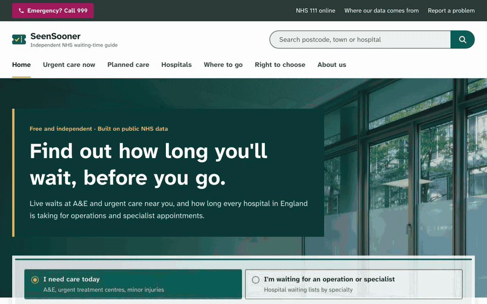
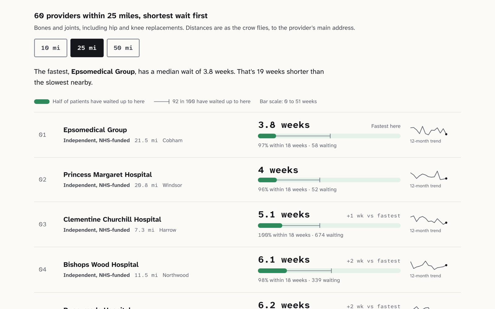
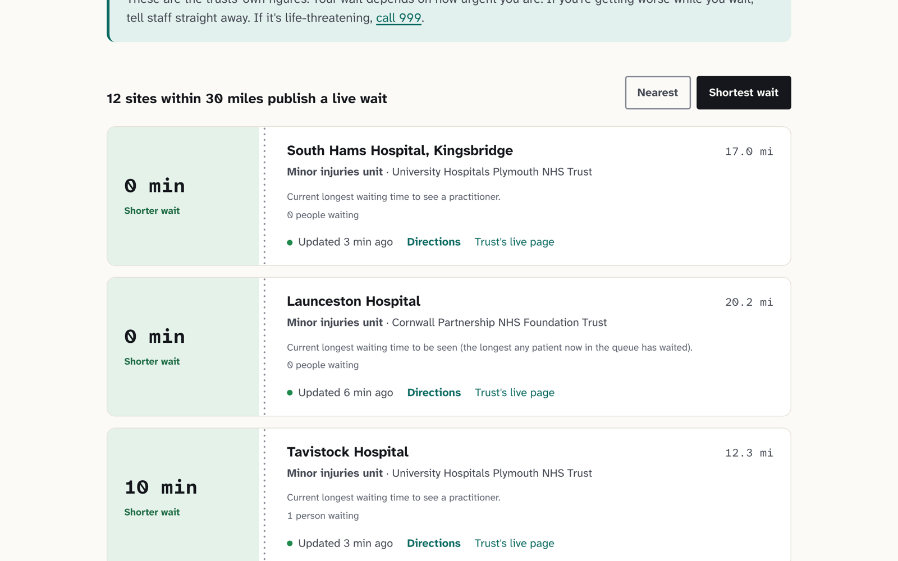
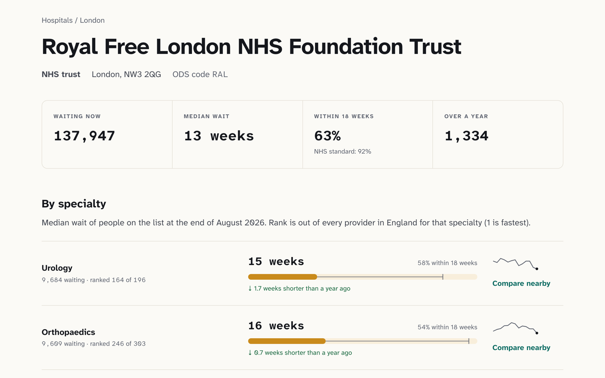
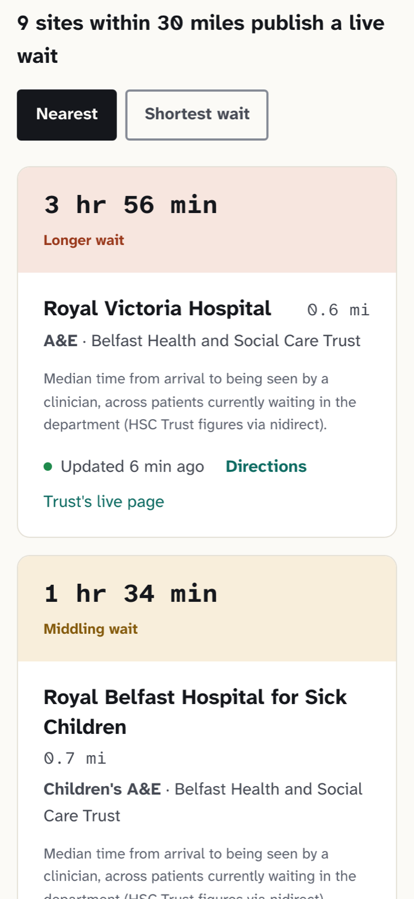
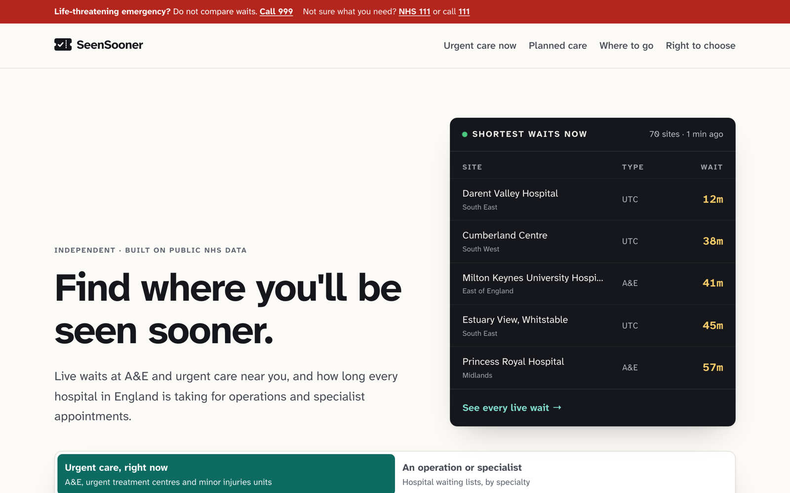

# SeenSooner

**Find where you'll be seen sooner.** Live A&E and urgent care waits near you, and how long every
hospital in England is taking for operations and specialist care.

      

**Live: https://seensooner.kishankanejiiya.tech**



> [!IMPORTANT]
> SeenSooner is an independent project. It is not part of, funded by or endorsed by the NHS, and
> nothing on it is medical advice. In an emergency call 999. If you're not sure what you need, use
> [NHS 111](https://111.nhs.uk/).

## The problem

Two questions every NHS patient asks, and nowhere answers both:

1. **"I need urgent care now. Where will I be seen fastest?"** Some trusts publish a live A&E
   wait on their own website, each in a different format, buried a few clicks deep.
2. **"I'm being referred. How long will I wait, and can I go somewhere quicker?"** In England
   you have a legal right to choose where you're referred for most planned care, including
   independent hospitals that treat NHS patients for free. The waiting-time data is public but
   ships as an 80 MB monthly CSV, so almost nobody uses it.

The gap is real. In August 2026, for orthopaedics (hips, knees, bones and joints), half the
people waiting at Clementine Churchill Hospital had waited **5.1 weeks** or less. At the Royal
Free, 7 miles away, it was **16 weeks**. Across England the medians ran from 5.1 to 31 weeks.

## What it does

| Page | What you get | Source | Freshness |
| --- | --- | --- | --- |
| **Urgent care now** `/now` | A&E, urgent treatment centres and minor injuries units near a postcode, town or your location, sorted by distance or wait | 15 trust and health-board live pages, about 70 sites in England and Northern Ireland | Shared fetch every 5 min |
| **Planned care** `/planned` | Every provider within 10, 25 or 50 miles for 20 specialties, ranked by median wait, with a 13-month trend | NHS England RTT full extract, 506 providers | Monthly |
| **Specialty and hospital pages** | 527 static pages: national rankings by region, and each hospital's waits by specialty | Same | Monthly |
| **Right to choose** | What the law says, how to ask your GP, and a message you can copy | NHS Constitution and Choice Framework | Static |
| **Where to go** | 999, A&E, urgent treatment centre, NHS 111, pharmacy or GP | NHS guidance | Static |

| Planned care near you | Live waits | A hospital's own page | Phone |
| --- | --- | --- | --- |
|  |  |  |  |



## How it works

```
                 every 5 min (shared by all visitors)
 15 NHS trust ──▶ lib/live/adapters/*  ──▶ unstable_cache ──▶ /now, home board
 live pages       one parser per source     Promise.allSettled,
                  normalised to LiveSite    8 s timeout each,
                                            one failure never breaks the page

                 monthly
 NHS England ───▶ scripts/ingest_rtt.py ──▶ web/data/rtt.json ──▶ /planned, /hospital/*, /planned/*
 RTT CSV (13 mo)  weekly buckets → median,    750 KB, baked         static + ISR
 NHS ODS + postcodes.io   p92, % < 18 wk, trend
```

- **No backend, no database, nothing stored about visitors.** Server components do the work.
  "Use my location" goes straight into the URL and is never logged.
- **Live adapters never invent a number.** If a page changes shape, that adapter throws and the
  site lists the source as unreachable. Every result shows the trust's own definition ("longest
  wait to be seen", "median time to a clinician") and its own update time, and is flagged "may be out of
  date" once the source is two hours old.
- **Banded sources stay honest.** When a trust only says "more than 2 hours", the site shows
  `2 hr+`, not a precise-looking `2 hr 0 min`.
- **Low load on NHS sites.** One request per source per five minutes, however busy SeenSooner gets.
- **The planned-care maths.** The CSV gives counts in 105 weekly buckets per provider and
  specialty. The ingest interpolates the median and 92nd percentile inside the bucket, drops
  combinations with fewer than 20 people waiting, and geocodes providers via the NHS
  Organisation Data Service and postcodes.io. It uses only the Python standard library.
- **Hardened deploy.** A read-only container with all capabilities dropped and a 320 MB memory cap,
  bound to loopback and served through a Cloudflare Tunnel with no open inbound ports.

## Design decisions

- **Atkinson Hyperlegible (Next + Mono)**, drawn by the Braille Institute for low-vision readers.
  People check waits when they're anxious, unwell or older, often on a phone in a corridor.
  Every number is in the mono cut so columns line up.
- **Number + bar length + colour**, never colour alone. Text colours are checked at 4.5:1 or more,
  and the search, sort and action controls are at least 48 px tall.
- **The 999 strip comes first on every page.** The site must never slow down an emergency.
- **Not NHS-branded.** The open-source NHS design system is MIT-licensed, but its look would make an
  independent site read as official. So SeenSooner has its own identity: the mark is a take-a-number
  queue ticket, and the home board is a railway departures board.

## Run it

```bash
cd web && npm install
npm run dev            # http://localhost:3108
npm run test:live      # fetch every live source once and print a table; exits 1 on any failure
npm run lint && npm run typecheck
```

Refresh the planned-care data (NHS England publishes it monthly, usually on the second Thursday):

```bash
python3 -I scripts/ingest_rtt.py      # downloads are cached in data-raw/cache (git-ignored)
```

Deploy: `./deploy/deploy.sh` builds the Next.js standalone output on the dev machine and runs
it in Docker on the server. `REFRESH=1 ./deploy/deploy.sh` re-ingests first.

## Limits

- Live waits cover only the trusts that publish them: about 70 sites, mostly the South West, the
  Midlands, the North West, Kent and Northern Ireland. NHS Wales switched off its live service,
  and the one Scottish board with live data disallows automated access in robots.txt, so both are
  left out.
- A median is how long people *on the list* have waited so far, not a prediction of your wait.
  Independent hospitals often take simpler cases.
- Provider distances use each trust's main address, so for multi-site trusts they're approximate.

## Data and licence

Contains public sector information licensed under the
[Open Government Licence v3.0](https://www.nationalarchives.gov.uk/doc/open-government-licence/version/3/):
NHS England Consultant-led Referral to Treatment Waiting Times, and the NHS Organisation Data
Service. Postcode lookups by [postcodes.io](https://postcodes.io/) (ONS data). Live figures belong
to the trusts that publish them, and every result links back to the source page.

---

Built by [Kishan Kanejiya](https://linkedin.com/in/kishankanejiya).
